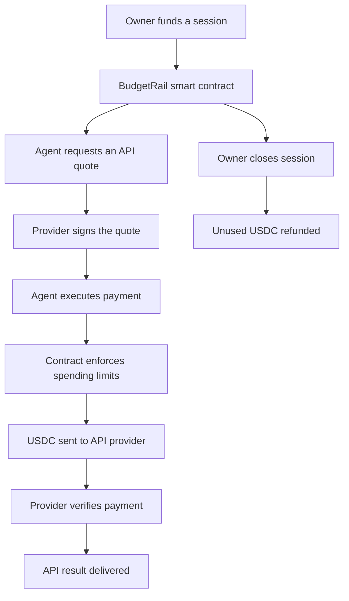
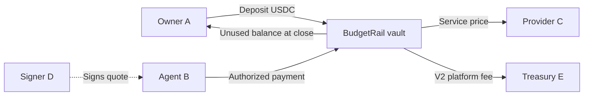
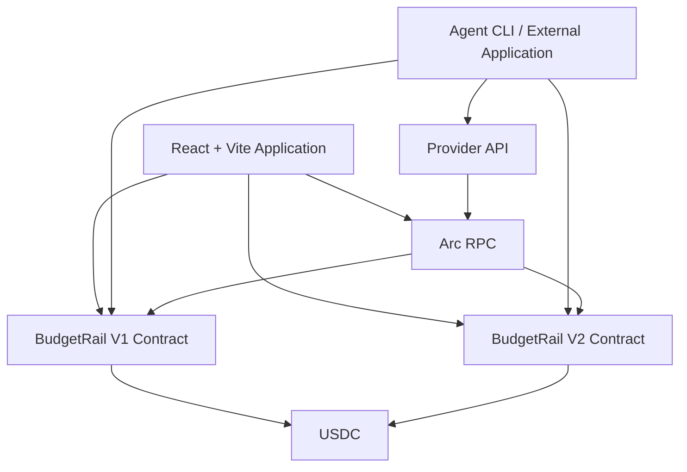

# BudgetRail

<div align="center">

### Give AI agents a budget. Not unlimited access to your wallet.

**Programmable USDC payments for software agents, built on Arc.**

Fund a secure onchain budget, authorize an agent, pay for API services, and reclaim whatever goes unused.

[](https://studio.arc.io)
[](https://arc.io)
[](https://www.circle.com/usdc)
[](https://soliditylang.org)

**[Launch BudgetRail](https://arc-budgetrail.vercel.app/)** · **[Arc Studio Project](https://studio.arc.io/app/d2021a13-e011-4429-a35c-6412d292728e)** · **[Arc Explorer](https://explorer.arc.io)**

</div>

---

## The problem

AI agents can perform useful work, but paying for external services introduces a difficult question:

**How can an agent spend money without receiving unlimited access to its owner's funds?**

Giving an autonomous agent direct access to a wallet creates unnecessary risk. Requiring a human to approve every API call removes much of the benefit of automation.

BudgetRail offers a middle ground.

An owner deposits a limited amount of USDC into a smart contract and authorizes one agent wallet to make purchases under predefined rules.

The agent can buy services without requesting a new approval from the owner for every purchase. The smart contract enforces the spending limits, and the owner retains control over unused funds.

## Meet BudgetRail

BudgetRail is a smart-contract-based payment infrastructure for **software-to-software and AI-agent payments**.

Instead of giving an agent unrestricted access to funds, BudgetRail lets owners define how much can be funded, how much can be spent on each purchase, which agent may spend, and when spending permission expires.

| Capability | What it means for users |
|---|---|
| **Funded payment sessions** | Deposit USDC into a contract-controlled budget |
| **Authorized agent wallets** | Only the selected agent can execute purchases |
| **Onchain spending limits** | Enforce maximum funding and per-payment caps |
| **Signed payment quotes** | Require a provider-authorized quote before settlement |
| **Verifiable USDC payments** | Record real transfers and payment events onchain |
| **Owner-controlled top-ups** | Add funds within a session's existing lifetime limit |
| **Refund unused funds** | Close a session and return the remaining USDC to its owner |
| **Payment history** | Inspect settlement events and transaction evidence |
| **Developer integrations** | Connect agent scripts and external applications to the payment flow |

The goal is simple: **make agent spending bounded, transparent and independently verifiable.**

---

## How it works



### A simple example

Imagine an AI agent that needs to purchase document-analysis reports.

The owner configures a session with a $5 maximum lifetime funding limit, deposits $1 initially, selects an agent wallet, and sets a spending cap.

The agent requests a document analysis, receives a signed quote, and submits an authorized payment.

Once the payment is confirmed, the provider verifies the onchain settlement and returns the purchased result.

The owner can later close the session and recover the unspent balance.

**The agent never receives unrestricted access to the owner's wallet.**

## Wallet roles and money flow

BudgetRail separates the participants in a payment into clearly defined roles.

| Role | Responsibility |
|---|---|
| **Owner A** | Creates the session, funds it, adds funds, closes it and receives refunds |
| **Agent B** | Executes authorized purchases from the funded session |
| **Provider C** | Receives payment for delivering the service |
| **Quote Signer D** | Signs payment quotations on behalf of the provider |
| **Treasury E — V2** | Receives the platform fee on fee-enabled V2 purchases |
| **BudgetRail contract** | Holds session funds and enforces payment rules |

These roles are defined by onchain addresses. A single wallet can hold multiple roles where the contract permits it.

The owner and agent may use the same wallet for manual demonstrations, but a separate agent wallet better represents the intended autonomous-payment use case.

### Where does the USDC go?



The smart contract does not give the agent ownership of deposited funds. The agent receives spending permission under the session's rules.

Service payments are final once settled. Closing a session refunds the unused balance, not amounts already paid to providers.

---

## Transparent payments and platform fees

BudgetRail supports a separate fee-enabled V2 contract design with a **fixed 0.5% platform fee added to the API provider's price**.

For example:

| Payment component | Amount |
|---|---:|
| Document Insights service price | $0.050000 USDC |
| BudgetRail platform fee — 0.5% | $0.000250 USDC |
| **Total session debit** | **$0.050250 USDC** |

The provider receives the complete service price, while the designated treasury receives the additional platform fee.

The V2 contract design applies spending caps to the total debit and requires the payment split to settle atomically.

**V1 does not collect this platform fee.** Fee collection applies only to payments made through a correctly deployed and configured V2 contract.

There are no BudgetRail platform fees for creating, funding, topping up or closing sessions under this model.

---

## Explore the application

### 01 — Dashboard

The dashboard gives users visibility into their payment sessions.

Owners can inspect funded budgets, available balances, spending activity and session status.

Authorized agents can access sessions in which they have spending permission, even if the session was created by another wallet or browser.

### 02 — New Budget

Create a spending session by defining the authorized agent, lifetime funding maximum, per-payment limit, expiry and initial deposit.

The UI identifies the connected owner and displays the configured provider and signing addresses before confirmation.

### 03 — Manage Session

Inspect an individual session's stored onchain roles, balances and status.

Owners can add funds within the allowed maximum or close the session to recover the remaining balance.

Agents receive access to the relevant payment workflow without receiving owner-only permissions.

### 04 — API Playground

Experience the core software-to-software payment flow.

Request a signed quote for a supported API service, authorize the payment with the designated agent wallet, and receive the purchased result after the provider verifies the transaction.

The payment and fulfillment steps are separate, allowing confirmed payments to be verified independently.

### 05 — Payment History

Explore settlement activity, session identifiers, agents, providers, amounts and transaction evidence.

Historical scanning and indexing are designed around contract events rather than trusting browser-local payment records.

### 06 — Developer Integrations

BudgetRail includes integration-oriented source code and examples for developers building agents, providers and applications.

The longer-term objective is to let other software products adopt bounded USDC spending without rebuilding the escrow, authorization and receipt-verification logic from scratch.

---

## Built on Arc — why this blockchain?

BudgetRail uses Arc as the settlement layer for programmable USDC payments.

Arc's EVM compatibility makes it possible to express spending permissions using Solidity smart contracts, while USDC provides the payment asset.

For BudgetRail, Arc provides:

- **Onchain enforcement:** Smart contracts control who may spend and under which limits.
- **USDC-native payment flows:** Deposits, provider payments and refunds use USDC.
- **Transaction-level evidence:** Payments can be inspected using transaction receipts and contract events.
- **Software composability:** External agents and applications can integrate with contract and provider interfaces.
- **Transparent accounting:** Users can distinguish funded amounts, settled payments, and unused balances.

The payment authorization rules are enforced onchain. The provider backend handles quote issuance, payment verification and delivery of the purchased service.

---

## Arc Mainnet — deployment and payment evidence

BudgetRail is designed for **Arc Microgrants: Built with Arc Studio**, where a working mainnet application and independently verifiable real-USDC transactions are essential.

| Evidence | Reference |
|---|---|
| Live application | [arc-budgetrail.vercel.app](https://arc-budgetrail.vercel.app/) |
| Arc Studio project | [Open BudgetRail in Arc Studio](https://studio.arc.io/app/d2021a13-e011-4429-a35c-6412d292728e) |
| Network | Arc Mainnet — chain ID `5042` |
| Mainnet V1 contract | **[INSERT VERIFIED ADDRESS]** |
| Mainnet V2 contract | **[INSERT IF DEPLOYED]** |
| USDC funding transaction | **[INSERT MAINNET EXPLORER LINK]** |
| Agent payment transaction | **[INSERT MAINNET EXPLORER LINK]** |
| Provider/treasury settlement evidence | **[INSERT MAINNET EXPLORER LINK]** |
| Refund transaction | **[INSERT MAINNET EXPLORER LINK, IF DEMONSTRATED]** |
| Demo video | **[INSERT PUBLIC VIDEO LINK]** |

The mainnet contract address and payment transaction should link directly to [Arc Explorer](https://explorer.arc.io), allowing reviewers to independently verify the contract interaction and USDC transfers.

**Only confirmed Arc mainnet transactions qualify as mainnet evidence.** Testnet transactions and frontend screenshots are useful for development demonstrations but are not substitutes for real mainnet settlement.

---

## Built with Arc Studio

BudgetRail was developed through an iterative Arc Studio workflow, covering smart-contract design, tests, application implementation and integration.

The development process included:

1. Designing the owner-funded payment-session contract and authorized agent roles.
2. Implementing Solidity contracts and automated tests.
3. Building the React interface around the contract interactions.
4. Integrating provider-signed quotes and USDC settlement verification.
5. Testing payment authorization, budget limits and refunds.
6. Refining wallet-role handling, historical data and multi-browser workflows.
7. Designing a separate V2 contract for additive platform-fee splitting.
8. Preparing the application for independent deployment and public use.

The original [Arc Studio project](https://studio.arc.io/app/d2021a13-e011-4429-a35c-6412d292728e) provides the development provenance.

---

## Architecture



### Technology stack

| Layer | Technologies |
|---|---|
| Blockchain | Arc, EVM |
| Smart contracts | Solidity, OpenZeppelin |
| Smart-contract testing | Foundry |
| Frontend | React, TypeScript, Vite |
| Wallet and chain integration | wagmi, viem |
| Provider backend | TypeScript, Bun and serverless endpoints |
| Agent integration | TypeScript CLI and SDK source |
| Hosting | Vercel |
| Onchain data | Contract events, transaction receipts, Arc RPC |
| Development | Arc Studio |

### Repository structure

```text
BudgetRail/
├── contracts/
│   ├── BudgetRail.sol
│   ├── BudgetRailV2.sol
│   └── test/
│
├── src/
│   ├── pages/
│   ├── components/
│   ├── hooks/
│   └── lib/
│
├── api/
│   ├── rpc
│   ├── health
│   ├── quotes
│   └── fulfill
│
├── provider/
│   └── src/
│
├── agent/
│   └── src/
│
├── packages/
│   └── sdk/
│
├── examples/
├── docs/
├── evidence/
└── README.md
```

The repository separates contracts, user-facing interfaces, payment-provider verification, and developer integrations.

---

## Run locally

<details>
<summary><strong>Developer setup</strong></summary>

### Prerequisites

- Bun and a compatible Node.js environment
- Foundry for Solidity development and testing
- An EVM-compatible wallet
- Access to an Arc RPC endpoint
- Test USDC for testnet transaction testing

### Install and start

```bash
bun install
bun run dev
```

### Run Solidity tests

```bash
forge build
forge test
```

### Environment configuration

Configure the frontend's public network and contract settings separately from server-side secrets.

Example frontend configuration:

```dotenv
VITE_ARC_NETWORK=testnet
VITE_BUDGET_RAIL_ADDRESS=<DEPLOYED_CONTRACT>
VITE_PROVIDER_PAYOUT=<PROVIDER_PUBLIC_ADDRESS>
VITE_QUOTE_SIGNER=<SIGNER_PUBLIC_ADDRESS>
VITE_PROVIDER_API_URL=/api
```

The provider backend requires matching chain, contract and recipient configuration.

`QUOTE_SIGNER_PRIVATE_KEY` belongs **only in protected backend secrets**, never in frontend variables, committed `.env` files or the public repository.

Use the deployed contract's correct ABI and chain ID. Do not mix testnet and mainnet contract addresses.

</details>

---

## Security and trust model

BudgetRail is designed to reduce the permissions granted to an agent.

Its smart-contract authorization model includes owner-only funding and closing, agent-only payment execution, signed provider quotes, spending caps, expiry and replay protection.

Important limitations still apply:

- Deposited USDC is held by smart-contract escrow and is exposed to smart-contract risk.
- API payments already settled onchain are not reversed when a session is closed.
- A confirmed blockchain payment does not by itself guarantee API availability or result quality.
- Expired sessions do not refund themselves; the owner must close them.
- The provider's quote-signing key must remain secure.
- The agent requires its own ability to pay Arc transaction fees.
- Transaction histories and account balances should be verified against the correct network and contract.
- No third-party security audit is claimed unless independently documented.

**Do not deposit more than you can afford to risk.** BudgetRail is experimental software, and all contract deployments should be reviewed before production use.

---

## Where BudgetRail can go next

BudgetRail begins with a focused use case: enabling an authorized agent to purchase an API response from a funded USDC session.

The architecture also creates opportunities for:

- More paid API integrations and independent providers.
- Reusable agent SDKs and simpler developer onboarding.
- Provider discovery and service pricing catalogs.
- Improved transaction indexing and payment observability.
- Operational tooling for quote-signing key management.
- Additional spending policies and payment automation.
- Carefully reviewed integrations with other agent-payment standards.

The long-term direction is a reusable payment layer for applications that need **controlled, programmable spending rather than unrestricted wallet access**.

---

## Arc Microgrants submission

**Program:** Arc Microgrants — Built with Arc Studio  
**Category:** Software-to-software / AI-agent payments, smart-contract escrow and payment splitting  
**Built with:** Arc Studio  
**Builder profile:** [INSERT PUBLIC BUILDER PROFILE]  
**Walkthrough:** [INSERT VIDEO LINK]

### What this submission demonstrates

BudgetRail brings together three distinct functions:

**Onchain authorization:** A wallet owner creates a funded spending session with contract-enforced limits.

**Agent-initiated settlement:** An authorized agent can purchase a provider's service without obtaining another owner signature for each payment.

**Independent verification:** The provider verifies an actual onchain USDC payment before returning the purchased result, and the owner can recover unused session funds.

The fee-enabled V2 design extends this with an additive 0.5% split between the service provider and a designated platform treasury.

The goal is to demonstrate that **AI agents can participate in real payments while remaining subject to explicit human-defined spending boundaries**.

---

## Built for the next generation of software payments

Today, most software pays through conventional accounts and recurring subscriptions. As more applications delegate work to autonomous agents, those agents will need ways to purchase services without receiving unrestricted financial authority.

BudgetRail explores one approach: **pre-funded, contract-enforced spending sessions with verifiable USDC settlement**.

Built with Arc Studio. Powered by USDC. Designed for programmable software payments.

<div align="center">

**[Try BudgetRail](https://arc-budgetrail.vercel.app/) · [View Arc Studio Project](https://studio.arc.io/app/d2021a13-e011-4429-a35c-6412d292728e) · [Explore Arc](https://arc.io)**

</div>

---

*BudgetRail is an independent experimental application. It is not affiliated with or endorsed by Circle or Arc. Smart contracts and blockchain transactions involve risk.*
